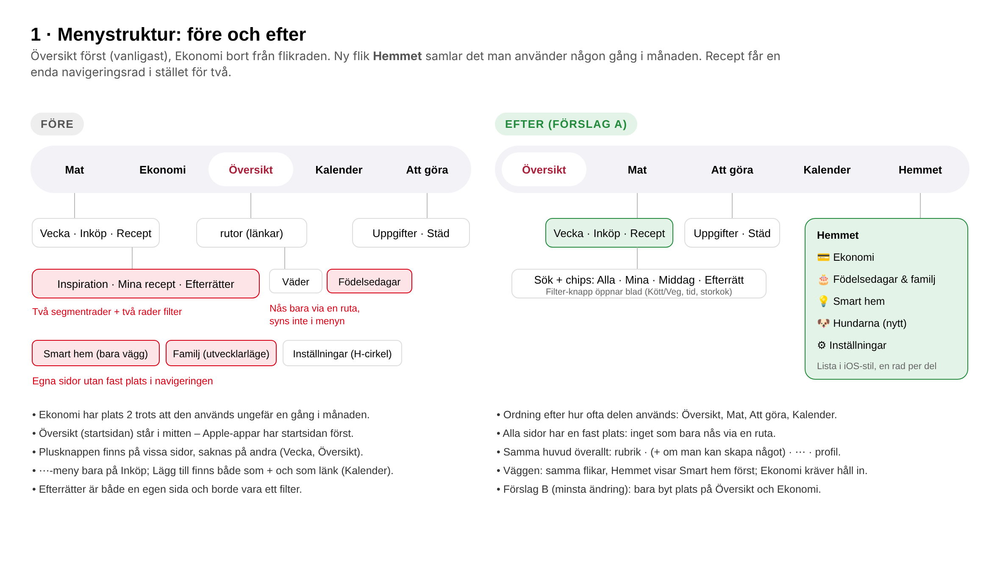
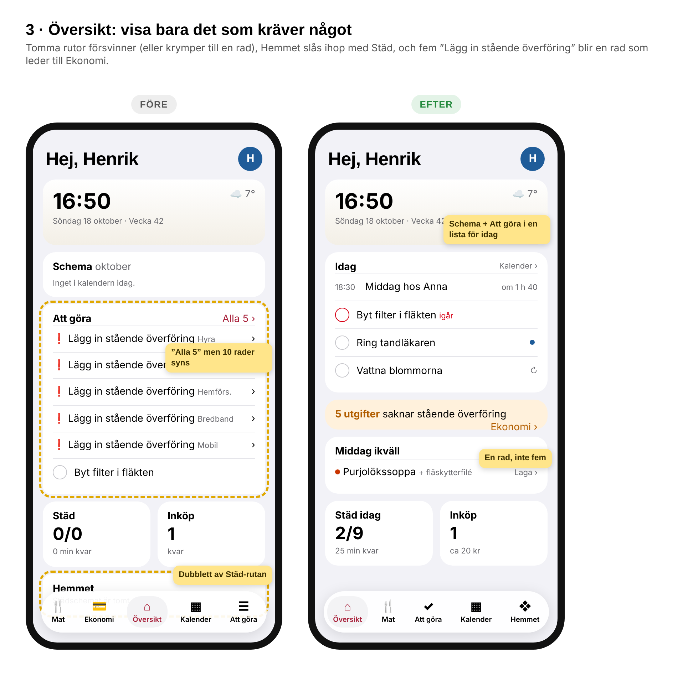
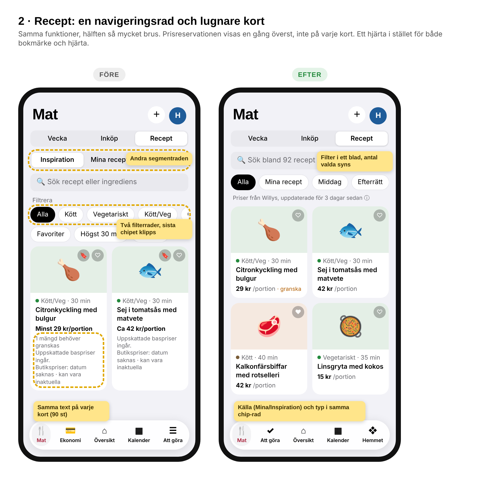
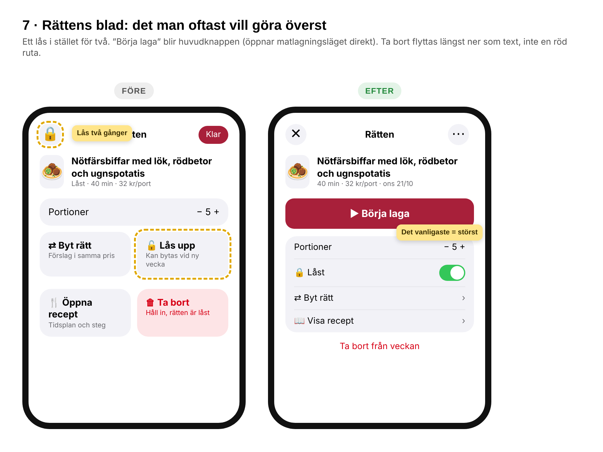
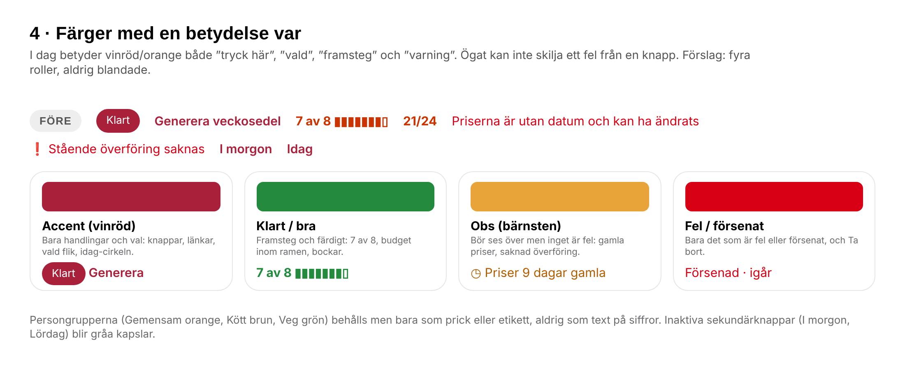
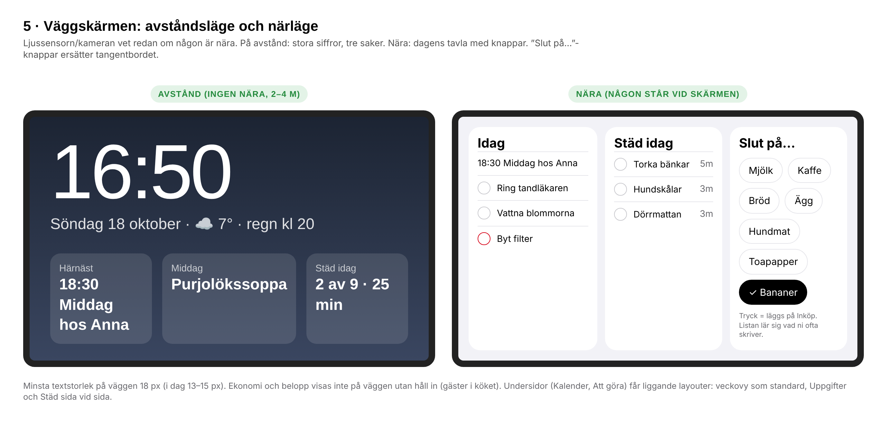
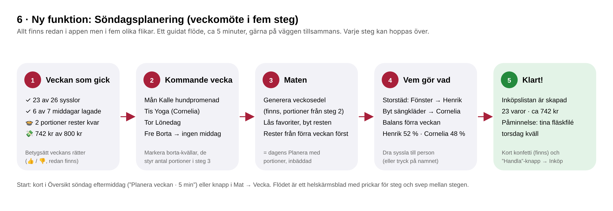

# Expertgranskning av Hushållstavlan – november 2026

Granskad version: `main` @ `22f992a` (ht-v330), UI 5.0 (Apple) som standard, telefon 390×844 och väggskärm 1368×912, ljust läge, emulatorn med både ögonblicksbilden och realistiska testdata (uppgifter, händelser, sysslor, ekonomi). Granskningen är ett **förslag**. Inget här är godkänt att publicera förrän Henrik har valt.

Bilderna i den här mappen (`1-…png` till `7-…png`) är skisser som visar idén, inte färdig design.

---

## 0. Till agenten som ska genomföra detta (Opus 5.5, Claude eller Codex)

1. Läs `AGENTS.md` och `OVERLAMNING.md` först. Reglerna där gäller före allt i det här dokumentet.
2. Ta **ett arbetspaket i taget** (rubrikerna A–L nedan), en gren och en PR per paket. Börja i den ordning som står i avsnitt 1.
3. Varje visuell ändring: visa Henrik 1–2 bilder före/efter (skill `hushallstavlan-forhandsvisa`). Där det står **”Välj A/B”** ska Henrik välja innan du bygger.
4. Bygg bara i UI 5.0 (`U5`, CSS under `html.ny.ui5`) om inget annat sägs. UI 2.0/4.0/Aura ska se ut som förut tills Henrik bestämt sig om paket K.
5. Hitta koden med `node verktyg/karta.js <namn>` och `node verktyg/rutor.js <ruta>`. Läs aldrig hela `app.js` (924 kB) eller `index.html` (320 kB).
6. Testa med `alla-flikar.js` i telefon och vägg, plus ett eget scenario per paket som kontrollerar acceptanskriterierna med text. Realistiska testdata: se `verktyg/emu/stad-data.js` och mönstret i avsnitt 7 nedan.
7. Ingen ändring här kräver ny `Kod.gs`, utom där det uttryckligen står. Återanvänd `onskelista` för nya hushållsdata.
8. Markeringen **[verifierat]** betyder att jag sett det i appen eller koden. **[antagande]** betyder att det bör kontrolleras först.

---

## 1. Sammanfattning och prioritering

Hushållstavlan är redan ovanligt genomarbetad för en hemmaapp: riktigt bra veckosedel med budget och portioner, en levande väderbild med karaktär, väggtavla med ljussensor, Smart hem i Apple-stil och genomtänkta gester. Det som skiljer den från en ”polerad” app är inte fler funktioner utan **mindre brus, en tydligare struktur och färre parallella val**. Appen har vuxit genom många små A/B/C-beslut, och det märks: samma sak går att nå på flera sätt, vissa sidor saknar fast plats, och varningar ser ut som knappar.

| Prio | Paket | Varför | Storlek |
|---|---|---|---|
| 1 | **G. Färgroller** | Röd/vinröd betyder i dag både ”tryck”, ”framsteg” och ”fel”. Grund för allt annat. | Liten (CSS) |
| 2 | **B. Översikt utan brus** | Startsidan visar tomma rutor och dubbletter; ”Alla 5” men 10 rader. | Liten–mellan |
| 3 | **C. Mat: Recept och rättens blad** | Två segmentrader, prisreservation på varje kort, två lås. | Mellan |
| 4 | **A. Menystruktur** (välj A/B) | Ekonomi på plats 2, sidor utan fast plats, olika huvuden. | Mellan |
| 5 | **H. Väggskärmen på avstånd** | 13–15 px text i ett kök, telefonlayouter på väggen, ingen snabbinmatning. | Mellan–stor |
| 6 | **D–F. Att göra, Kalender, Ekonomi** | Konkreta småfel och onödig text. | Liten per punkt |
| 7 | **I. Animationer** | Bra grund; saknar sammanhängande övergångar mellan kort och detalj. | Mellan |
| 8 | **K. Färre val** | 57 enhetsinställningar och fem designsystem. Kräver Henriks beslut. | Beslut + städning |
| 9 | **L. Utvecklarhälsa** | Versionsnummer som inte stämmer, överlämning som vuxit, dokumentation som släpar. | Liten |
| 10 | **M. Nya funktioner** | Söndagsplanering, ”Slut på…”, elpris, sophämtning, hundarna. | Var för sig |

---

## A. Menystruktur och navigering — Välj A/B



**Nuläge [verifierat]**
- Flikraden: `Mat · Ekonomi · Översikt · Kalender · Att göra` (Översikt i mitten).
- Ekonomi har andra platsen trots att den används ungefär en gång i månaden.
- Väder och Födelsedagar nås bara genom att trycka på en ruta i Översikt. Smart hem finns bara på väggen, Familj bara i utvecklarläget. Inställningar ligger bakom profilcirkeln.
- Mat har tre segment (Vecka/Inköp/Recept) och under Recept ytterligare tre (Inspiration/Mina recept/Efterrätter) – två segmentrader på varandra.
- Sidhuvudena skiljer sig: Översikt har bara profil, Mat → Vecka profil, Inköp `⋯ + profil`, Kalender `+ profil` och dessutom en länk ”Lägg till” under datumet (samma sak två gånger). `addContext()` ger ingen plusknapp på Vecka eller Översikt.

**Förslag A (rekommenderas)**
- Flikrad: `Översikt · Mat · Att göra · Kalender · Hemmet`. Översikt först som i Apples egna appar, sedan efter hur ofta delen används.
- Ny flik **Hemmet** = en inset-lista i iOS-stil (samma komponent som Inställningars första sida): Ekonomi, Födelsedagar och familj, Smart hem (bara när `haUrl` finns), Hundarna (se M5), Inställningar. Varje rad öppnar befintlig vy med push-övergången som redan finns (`u5Sida`).
- Väder stannar som detaljsida från Översikt (det är naturligt att trycka på vädret).
- På väggen: samma flikar. Hemmet visar Smart hem överst. Ekonomi kräver håll in på väggen (se H4).
- **Ett sidhuvud överallt**: stor rubrik · `+` om man kan skapa något på sidan · `⋯` om sidan har fler åtgärder · profil. Ta bort textlänkar som gör samma sak som `+` (Kalenderns ”Lägg till” under datumet).

**Förslag B (minsta ändring)**
- Byt bara plats: `Översikt · Mat · Kalender · Att göra · Ekonomi`. Födelsedagar får en rad i Inställningar → ”Hemmet”. Inga nya vyer.

**Var i koden:** flikraden i avsnittet ”flikrad” (`app.js` 191–585), `navLins` (linsen räknar flikar; kontrollera att indexering inte är hårdkodad), `addContext()` rad ~918, `S.view`-värden. Rutor som berörs: inga nya; Hemmet-vyn får nästa lediga nummer under en ny bokstav, t.ex. `H1` (lägg till delen `H` i `verktyg/rutor.json`).

**Acceptans**
- Alla vyer går att nå från flikraden i högst två tryck, utan att gå via en ruta.
- Sparad `ht.view` för en flik som inte längre finns (t.ex. `ekonomi`) öppnar rätt vy utan krasch. Testa uppstart med `LS={"view":"ekonomi"}`.
- Linsens fjäder och svep mellan flikar fungerar med nya ordningen (`flikrad-lins.js`, `ui5-gester.js`).

---

## B. Översikt: visa bara det som kräver något



**Nuläge [verifierat]**
1. Rutan **Att göra** (Ö3) blandar in ”Lägg in stående överföring” från Ekonomi, en rad per utgift (`V.oversikt`, rad ~1591). Med fem utgifter blir det fem nästan likadana rader med rött utropstecken överst, före riktiga uppgifter. Rubriken säger ”Alla 5” medan rutan visar tio rader.
2. **Hemmet** (Ö7) säger ”Städschemat är tomt.” samtidigt som **Städ** (Ö5) visar 0/0. Två rutor för samma sak.
3. Tomma rutor tar full plats: ”Inget i kalendern idag.”, ”Inget att göra just nu.”, ”Inga händelser.”
4. Timremsan under hundbilden (Ö11) visar `17 18 19 …` utan enhet; precis under finns Schemats datumrad `18 19 20 …`. Två sifferrader med olika betydelse.

**Förslag**
- Slå ihop **Schema** och **Att göra** till en ruta **Idag**: dagens händelser (med tid) och uppgifter (med bock) i en lista sorterad efter tid; försenade först med röd ring. Behåll ”Kalender ›” i rubriken. Veckoraden med datum kan ligga kvar ovanför listan (den är bra), men bara en sifferrad ska synas utan förklaring.
- Ekonomins påminnelser blir **en** rad i bärnsten: ”5 utgifter saknar stående överföring · Ekonomi ›”. Den hör inte hemma bland uppgifterna.
- Slå ihop Städ och Hemmet till **Städ idag** (antal, minuter kvar, rummens status som tunn stapel vid tryck).
- Tomma rutor: göm dem, eller krymp till en rad med grå text (`Inget idag`) om rutan är fast i layouten. Undantag: Middag ikväll ska alltid synas (då med knappen ”Planera veckan”).
- Timremsan: första kolumnen ”Nu”, sedan `18`, `19` … med liten `:00` eller en klocksymbol i rubriken, så den inte förväxlas med datum.
- ”Middag ikväll”: lägg en tydlig knapp **Laga ›** som öppnar matlagningsläget (`M27`) direkt.

**Var:** `V.oversikt` (1567), rutorna Ö2–Ö8, `wallBd`/väggens T3/T7/T8 för samma logik på väggen.

**Acceptans:** med testdata från avsnitt 7 visar Översikt högst en rad om stående överföringar; inga två rutor säger samma sak; tom kalender + inga uppgifter ger ingen tom ruta.

---

## C. Mat

### C1. Recept: en navigeringsrad och lugnare kort



**Nuläge [verifierat]**
- Två segmentrader (Vecka/Inköp/Recept och Inspiration/Mina recept/Efterrätter), rubriken ”Filtrera”, två rader filterchips där sista chipet klipps (”G…” = Gemensam).
- Varje kort (90 st) upprepar ”Uppskattade baspriser ingår. Butikspriser: datum saknas · kan vara inaktuella”. Sidan blir 20 000 px hög i telefonen.
- Kort har både bokmärke och hjärta. Skillnaden syns inte.
- Efterrätter är både en egen undersida och en kurs (`course:'efterrätt'`).

**Förslag**
- En rad: sökfält + knappen **Filter** (blad med Kött/Vegetariskt/Kött-Veg/Gemensam, Högst 30 min, Storkok; knappen visar antal valda filter).
- En chip-rad: `Alla · Mina recept · Middag · Efterrätt · ♥`. ”Mina recept” = receptbanken, ”Alla” = inspiration + mina. Ta bort undersegmentet.
- Prisreservationen visas **en gång** ovanför listan: ”Priser från Willys, uppdaterade för 3 dagar sedan ⓘ” (ⓘ öppnar förklaringen som finns i dag). På kortet bara `29 kr /portion`, och ett bärnstensfärgat ”granska” när en mängd behöver granskas.
- Ett hjärta (= favorit). ”Spara till Mina recept” flyttas till receptsidan.
- Behåll `S.matTab`-värdena `recept|bank|efter` internt så att sparade lägen och tester fungerar, men rita dem som chips.

**Var:** M12 (sök/filter), M13 (receptkorten), `RC`-tillståndet, `prisAlder`/`prisVarning`.

### C2. Veckan (Mat → Vecka)
- **[verifierat]** Rubrikkortet visar `20 kr av 800 kr` och längst upp till höger `21/24` i orange. Det är oklart att 20 kr är kvarvarande inköp och vad 21/24 räknar. Förslag: rubrik ”Veckans mat”, huvudtal = beräknad kostnad för hela veckan, under det ”780 kr kvar av budget”. Portionerna skrivs ut: ”21 av 24 portioner planerade”.
- **[verifierat]** ”7 av 8” och portionsstaplarna är orange-röda. Framsteg ska vara neutrala eller gröna (paket G). Grönt först när det är fullt.
- Plusknappen saknas på Vecka. Låt `+` öppna ”Lägg till en rätt” (samma blad som tomma platsen).

### C3. Rättens blad



- **[verifierat]** Låset finns två gånger (cirkeln uppe till vänster och rutan ”Lås upp”). Ta bort rutan, behåll en brytare ”Låst” i listan (cirkeln kan ligga kvar som ikon om Henrik vill, men inte båda som knappar).
- Det man oftast gör med en rätt den dagen är att laga den. Gör **Börja laga** till huvudknapp (fylld, full bredd) som öppnar matlagningsläget. ”Visa recept” blir en vanlig rad.
- ”Ta bort” som stor röd ruta drar blicken. Gör det till röd text längst ner (håll in-skyddet för låsta rätter behålls, `dishDelHold`).

### C4. Inköp
- **[verifierat]** ”Priserna är utan datum och kan ha ändrats” står i röd text överst. Gör den bärnstensfärgad och liten, eller visa den bara när `prisAlder` > 7 dagar.
- **I butiken-läge** [nytt]: när Inköp öppnas och listan har ≥ 5 varor, erbjud ”Handla nu” som håller skärmen vaken (wake lock finns redan för timers), större bockar, och sorterar efter Willys gångordning (kategorierna finns i `matvaror.js`). Bockade varor glider ner till ”I korgen” med en kort animation.

---

## D. Att göra och Städ

- **[verifierat]** Städ-sidan är mycket lång: Hur mycket ork, Dagliga rutiner, Dagens pass, Har ni mer tid, Hemmet just nu, Storstäd som närmar sig, Alla sysslor och intervall. Allt är bra, men inte samtidigt. Förslag: överst **Idag** (dagliga rutiner + dagens pass i en lista med bockar), ork-väljaren som tre små kapslar i rubriken (`Lite · Normal · Mycket`), sedan **Kommande** (storstäd), och ”Hemmet just nu” + ”Alla sysslor” bakom en rad ”Planering ›”.
- **[verifierat]** Varje rad i Dagens pass har en röd kapsel ”I morgon”, och Storstäd har två (”Lördag” och ”Idag”). Det ger en vägg av röda knappar. Gör dem gråa (`--fill`) och flytta dem till svep-åtgärder (svep åt vänster finns redan för Ta bort). Kvar på raden: bock + titel + minuter.
- Tom Städ-sida visar sju tomma rumsfält ”Ny syssla +”. Erbjud i stället ”Börja med vår mall” (de 23 sysslorna i `stad-data.js` är en bra start) och visa rummen först när något finns.
- Uppgifter: rubriken ”Försenade” i rött är bra. Lägg till en enkel bocka-av-animation som drar raden till Klara (finns som `checkAnim`/`leaveAnim`; kontrollera att den syns i UI 5.0).

## E. Kalender

- **[verifierat]** Lördagar och söndagar är gråa i månadsvyn, samma grå som dagar i föregående/nästa månad. Det läses som ”inte den här månaden”. Gör helgdagar till vanlig svart (eventuellt något ljusare kolumnrubrik L/S).
- **[verifierat]** Händelsens titel (”Middag hos Anna”) är centrerad i raden medan uppgifterna under är vänsterställda. Vänsterställ.
- **[verifierat]** Matraderna visar ”Sön · 43 kr/port” trots att vald dag redan är söndag. Ta bort veckodagen här.
- **[verifierat]** Förklaringen ”Händelserna kommer från Google Kalender och uppdateras var 15:e minut…” står alltid längst ner. Flytta till `⋯` → ”Om kalendern”, eller visa en gång.
- Dubbelt ”Lägg till” (se A).
- På väggen: standardvy **Vecka** (se H3).

## F. Ekonomi

- **[verifierat]** Varje fast utgift utan stående överföring får röd ikon och röd text ”Stående överföring saknas”. Med fem utgifter är halva sidan röd. Förslag: en bärnstensfärgad rad överst ”5 utgifter saknar stående överföring · Visa”, och på raden bara en liten bärnstensprick.
- Siffror ”−0 kr” när inget är ifyllt: visa ”–” eller göm summeringen tills inkomst finns.
- Ekonomi på väggen: se H4.
- Saknas: **riktiga utgifter** – efter ett inköp, fråga ”Vad kostade det?” (ett tal) och spara per vecka. Då kan matbudgeten visa planerat mot verkligt och prisuppskattningarna kalibreras (se M7).

---

## G. Färger med en betydelse var



**Nuläge [verifierat]:** accenten (vinröd) används för knappar, länkar, vald flik, idag-cirkeln och sekundärknappar (”I morgon”, ”Idag”). Orange `--gem-ink`/`--orange` används för framsteg (”7 av 8”, ”21/24”) och personetiketten Gemensam. Systemrött används för fel, försenat och informationstext (”Priserna är utan datum…”). Resultatet: ögat kan inte skilja en varning från en knapp.

**Förslag – fyra roller, aldrig blandade:**

| Roll | Token (ny) | Används till | Inte till |
|---|---|---|---|
| Accent | `--accent` (vinröd, som i dag) | Primärknappar, länkar, vald flik, idag | Siffror, status |
| Klart/bra | `--ok` = `--green` | Framsteg, färdigt, inom budget | Knappar |
| Obs | `--obs` (bärnsten, ljust `#B25E00` text / `#FFF1DC` yta; mörkt `#FFB340`) | Gamla priser, saknad överföring, granska | Fel |
| Fel/försenat | `--red` | Försenat, fel, Ta bort | Information |

- Sekundära kapselknappar (I morgon, Lördag, Inte nu) blir gråa (`--fill` + `--ink`).
- Personfärgerna (Gemensam/Kött/Veg) behålls som prick eller etikett, inte som färg på siffror.
- Gör detta som CSS-tokens under `html.ny.ui5` och ersätt hårdkodade färger på de platser som listas i D, E, F, C2 och C4. Kontrollera ljust och mörkt.

---

## H. Väggskärmen



**Nuläge [verifierat]:** Översikten på väggen är fin, men text i rutorna är 13–15 px (mätt i Mat-vyn på väggen). Undersidorna är telefonlayouter utdragna i bredd: Kalender visar månadsrutnät över hela bredden, Att göra en smal lista i mitten med tomma sidor. Det finns inget sätt att skriva in något (inget tangentbord).

**H1. Avståndsläge och närläge.** Väggdatorn har ljussensor och kamera (`kamera`, `kamLux` i localStorage). När ingen rört skärmen på 2 minuter (eller kameran inte ser någon nära, om det går): visa **avståndsläget** – stor klocka (≥ 110 px), datum och väder i en mening, tre brickor: Härnäst, Middag, Städ idag. Text ≥ 24 px. Tryck var som helst = vanliga tavlan. Dag/natt-färger som i dag. Det här är också bäst för skärmens livslängd (mindre rörelse och ljus).

**H2. Minsta textstorlek 18 px** på väggen i rutor och listor, 16 px för metatext. Tryckytor ≥ 56 px.

**H3. Liggande layouter för undersidor på väggen.** Kalender: Vecka som standard (`calVy`), med händelser i kolumner. Att göra: Uppgifter och Städ idag sida vid sida (inga segment). Mat → Vecka fungerar redan bra.

**H4. Sekretess.** Ekonomi och belopp syns för alla som står i köket. Gör Ekonomi på väggen till ”håll in för att visa” (eller dölj helt med en brytare under Inställningar → Enheten), och visa aldrig inkomster på väggen.

**H5. ”Slut på…”-knappar** (se M2).

**Acceptans:** `VP=1368x912` visar ingen text under 16 px (mät som i avsnitt 7), avståndsläget går in efter inaktivitet och ut vid tryck, Ekonomi kräver håll in.

---

## I. Animationer

**Nuläge [verifierat]:** stark grund – flikradens lins med fjäder (`navLins`), blad som följer fingret och stängs med svep (`bladStang`), push mellan sidor (`u5Sida`), `checkPop`/`tickDraw` för bockar, konfetti, väderbildens djur och moln, `prefers-reduced-motion` respekteras (33 ställen) och brytaren Rörelse finns. Det som saknas är **sammanhang mellan ytor**: när man trycker på ett kort hoppar innehållet i stället för att växa ur kortet.

**Förslag, i prioritetsordning**
1. **Kort → detalj med delat element.** Rättens bild på veckosedeln → rättens blad/receptsida; receptkort → receptsida; Smart hem-bricka → lampkort (finns redan som `haZoom`, använd samma teknik). Använd View Transitions API (`document.startViewTransition`, finns i Chromium och iOS 18+ Safari) med `view-transition-name` på bilden; fall tillbaka till dagens övergång när API:t saknas eller rörelse är av. Används inte i dag (0 träffar).
2. **Bocka av = raden lämnar listan**: bock ritas (finns), 250 ms senare kollapsar raden i höjd och nästa rader glider upp (FLIP med `transform`). Gäller uppgifter, städ och inköp på samma sätt.
3. **Siffror som ändras räknar** (budget, ”2 av 9”, Inköps antal): 300 ms räkning när värdet ändras, inte vid första ritningen.
4. **Laddning:** visa grå platshållare (skeleton) i rutornas form i stället för tom sida medan `apiGet` svarar; Apps Script tar sekunder.
5. **En rörelsevokabulär:** skriv ner tre kurvor och använd bara dem – fjäder för direkt manipulation (finns), `cubic-bezier(.2,.8,.2,1)` 280 ms för in, 200 ms för ut. Lägg dem som CSS-variabler och byt ut avvikande tider.

Regler som gäller (AGENTS.md 8): bara `transform`/`opacity` på HTML-element, inget på SVG. Mät med `verktyg/emu/lagg.js`.

---

## J. Tillgänglighet och läsbarhet

- Flikradens etiketter är ca 10–11 px. Apple använder 10 pt med fet vikt, men Hushållstavlan ska läsas av två personer i varierande ljus: gå till 11 px semibold och säkerställ kontrast 4.5:1 för grå metatext (`--ink-2` på `--surface`).
- Lägg `aria-label` på ikonknappar som saknar text (hjärta, bokmärke, lås, ⋯). Kontrollera med `pg.accessibility.snapshot()` i ett scenario.
- Respektera iOS textstorlek: använd `rem`/`-apple-system-body` för brödtext där det går, så att större text i iPhone följer med. **[antagande]** – mät först.

---

## K. Färre val, bättre standard — kräver Henriks beslut

**Nuläge [verifierat]:** 57 olika enhetsinställningar läses med `lsGet`, bland annat flera val som finns för att ett A/B-beslut aldrig stängdes: designval (UI 2.0, 4.0, 5.0, Aura; UI 3.0 i utvecklarläget), menyradens krympning (3 val), plusknappens plats (3), låsstil (2), segmentstil, timeranimation, städvy (Lista/Rutnät/Ring), väderstil (Original/Geometrisk), väderremsa (Dagskurva/Bild/Timme/Graf), hundfärg. CSS för fem designsystem ligger i samma `index.html` (UI 5.0 ≈210 regler, UI 4.0 ≈217, UI 3.0 ≈86, Aura ≈39).

Ett polerat intryck kommer från att någon har bestämt. Varje val dubblerar testningen och gör att buggar bara syns i en kombination.

**Förslag:**
1. Henrik väljer en standard per val. Val som ingen använder tas bort efter 30 dagar.
2. Behåll som riktiga val bara det som är personlig smak eller hårdvara: ljust/mörkt, accentfärg, rörelse av/på, väggläge, hundarnas utseende.
3. Pensionera UI 2.0, UI 3.0 och UI 4.0 (gör en sista ångra-gren `version-fore-en-design`). Aura kan leva vidare som ett *tema* (färger och typsnitt) ovanpå UI 5.0.
4. Inställningar har både iOS-sidor och Avbryt/Spara överst **[verifierat]**. iOS sparar direkt; Spara behövs bara för personnamn/färg. Spara direkt överallt utom i personbladet.

---

## L. Utvecklarhälsa

- **[verifierat]** Två versionsnummer glider isär: `sw.js` säger `ht-v330`, `index.html` laddar `app.js?v=320`, och Inställningar visar ”version 320” (`APP_VER` läses från `app.js?v=`). Henrik och agenterna pratar om ht-v330. Visa `ht-vNNN` i Inställningar (läs `VERSION` från sw eller skriv in den i `index.html`) och låt `verktyg/version.js` fortsätta höja båda.
- **[verifierat]** `OVERLAMNING.md` är 123 rader (målet är ≤ 50), och ”Pågår nu” innehåller ett tjugotal publicerade punkter. Flytta publicerat till git/PR, behåll bara öppna saker och ”Väntar på Henrik”.
- **[verifierat]** `AGENTS.md` säger att `app.js` är ≈530 kB och `index.html` ≈140 kB; i dag 924 kB och 320 kB. Uppdatera siffrorna. Om paket K genomförs krymper `index.html` mest.
- Uppstartstid: mät `app.js`-parsning på väggdatorn (Surface Pro 5) och en iPhone med Performance-panelen. Om > 300 ms: ladda `inspiration.json` och Familj/släktträd först när vyn öppnas (enkla `fetch`/dynamiska skript, inget byggsteg).
- Synkstatus: utkorgen (`OUTBOX`) är osynlig för användaren **[antagande – kontrollera om en indikator finns]**. Visa en diskret prick på profilcirkeln när något väntar > 10 s och ”Sparat” i 1 s när kön töms. Det bygger förtroende när Apps Script är långsam.
- Testdata: lägg mönstret från avsnitt 7 som `verktyg/emu/hushall-data.js` så att alla scenarier kan visa en ”levande” app i stället för tomma listor.

---

## M. Saknade funktioner och outtalade behov

Sorterat efter nytta för ett hushåll med två vuxna, två hundar och en köksskärm. Inget av detta finns i dag **[verifierat med sökning i app.js]**, utom där det står.

### M1. Söndagsplanering (veckomöte i fem steg) — störst nytta



Allt finns redan men i fem flikar. Ett guidat helskärmsblad: 1) Veckan som gick (sysslor, middagar, rester, budget, betyg som redan finns), 2) Kommande vecka från kalendern, markera borta-kvällar, 3) Generera veckosedel med portioner från steg 2 (återanvänd `planState`/`portAuto`), 4) Fördela storstäd och visa balansen mellan Henrik och Cornelia, 5) Klart: inköpslistan skapad, tina-påminnelser. Start från ett förslagskort i Översikt söndag eftermiddag (`forslag()` finns) eller knapp i Mat → Vecka. Fungerar på väggen med reglage, inget tangentbord.

### M2. ”Slut på…” – lägg till varor utan tangentbord
På väggen (och som snabbval i telefonens ”Ny vara”): chips med de 12 varor ni oftast lägger till (räkna från inköpshistoriken; börja med en fast lista). Ett tryck = på listan, tryck igen = av. Löser väggens största brist: man märker att mjölken är slut när man står i köket.

### M3. Elpris och apparaterna
Ni har diskmaskin (Home Connect) och Roborock i Smart hem. Visa timpris för elområdet (Värnamo ligger i SE3 – kontrollera) från ett öppet API, t.ex. elprisetjustnu.se, som en liten kurva i Smart hem och en rad i Översikt när det är billigt i kväll: ”Billigast el 02–05 · starta disken då?”. Steg 2: schemalägg starten via tjänsten på väggdatorn.

### M4. Sophämtning
Ett av de vanligaste hushållsbehoven. Lägg till som återkommande uppgift med eget utseende (tunnans färg) och påminnelse kvällen före på väggen: ”Ställ ut matavfallet ikväll”. Hämtdagar kan läggas in manuellt en gång (upprepning finns).

### M5. Hundarna
Hundarna är appens ansikte men har ingen egen funktion. En enkel sida under Hemmet: fästingskydd/avmaskning/vaccination/kloklippning som återkommande uppgifter med senast-datum, veterinärbesök i kalendern, vikt över tid, hundmat i ”Slut på…”. Väderbilden kan visa ”bra promenadfönster 15–17” (Vädra/Ute idag finns redan).

### M6. Rester och frysen
Målet ”allt som lagas blir uppätet” saknar en lista över vad som faktiskt finns kvar. ”I kylen” (rester med dagar kvar) och ”I frysen” (storkoksportioner) som veckosedeln använder först. `restpoang.js` poängsätter rester i förslagen men det finns ingen lista att bocka i **[antagande – verifiera]**.

### M7. Verklig kostnad efter handling
Fråga ”Vad kostade det?” när inköpslistan töms. Ger verklig matbudget per vecka/månad i Ekonomi och kalibrerar prisuppskattningen. Ett tal per inköp, sparas i `onskelista`.

### M8. Rättvis fördelning
Statistik i Städ: vem gjorde vad senaste 4 veckorna (minuter per person, data finns i `doneBy`). Visa neutralt, utan poäng och tävling. På väggen: när någon bockar av, fråga ”Vem?” med två namnknappar om enheten är gemensam.

### M9. Gå hemifrån-kort (morgon)
Kl 6–9 på vardagar: första kortet i Översikt och på väggen blir ”Idag”: första händelsen, vad du behöver ha på dig (finns), regn vid hemgång, och om hundarna hunnit ut.

### M10. Global sökning
Dra ned på Översikt (iOS Spotlight-mönster): sök över recept, uppgifter, varor, händelser och födelsedagar.

### M11. Gästläge på väggen
Se H4. En brytare ”Gäster hemma” som gömmer Ekonomi, privata uppgifter och namn på presenter i Födelsedagar.

### M12. Cornelias perspektiv
Appen är byggd av Henrik och mycket av texten utgår från honom. Fråga Cornelia vad hon använder och vad hon hoppar över; låt hennes telefon visa hennes veg-variant först i Middag ikväll och hennes uppgifter först.

---

## 7. Realistiska testdata för scenarier

Emulatorns ögonblicksbild har tomma uppgifter, händelser, städ och ekonomi. Lägg följande i början av ett scenario (som `stad-data.js` gör) och ladda om sidan:

```js
require('./stad-data.js');const gas=require('./gas');const B=gas.book.sheets;
[[false,'Ring tandläkaren','2026-10-18','Henrik','','t1','app',''],[false,'Betala hemförsäkring','2026-10-19','Cornelia','','t2','app',''],
 [false,'Köp present till Maja','2026-10-21','','','t3','app',''],[false,'Byt filter i fläkten','2026-10-17','Henrik','','t4','app','månad'],
 [false,'Vattna blommorna','2026-10-18','','','t5','app','vecka']].forEach(r=>B['Uppgifter'].rows.push(r));
[['2026-10-18','18:30','Middag hos Anna','','google','e1',''],['2026-10-19','08:00','Hundpromenad med Kalle','Henrik','google','e2',''],
 ['2026-10-20','17:00','Yoga','Cornelia','google','e3','']].forEach(r=>B['Händelser'].rows.push(r));
const S=B['Inställningar'].rows,set=(k,v)=>{const i=S.findIndex(r=>r[0]===k);i>=0?S[i][1]=v:S.push([k,v])};
set('ekonomi',JSON.stringify({shared:[{id:'hyra',name:'Hyra',amount:9800,period:'månad',day:'28',pay:'Autogiro'},{id:'el',name:'El',amount:900,period:'månad'}],
 personal:{Henrik:[{id:'tel',name:'Mobil',amount:249,period:'månad'}]}}));
set('ekonomi_inkomst',JSON.stringify({'2026-10':{Henrik:28500,Cornelia:26000}}));
// i scenariot: await pg.reload(); await h.idle(2500);
```

Textstorlek på väggen mäts så här (i scenariot):

```js
const m=await pg.evaluate(()=>{const r={};document.querySelectorAll('#main *').forEach(e=>{if(![...e.childNodes].some(n=>n.nodeType===3&&n.textContent.trim())||!e.offsetWidth)return;
 const f=Math.round(parseFloat(getComputedStyle(e).fontSize));r[f]=(r[f]||0)+1});return r});
```

---

## 8. Frågor till Henrik innan bygget

1. Meny: förslag **A** (Översikt först + ny flik Hemmet) eller **B** (bara byt plats på Översikt och Ekonomi)?
2. Får UI 2.0, 3.0 och 4.0 pensioneras så att bara UI 5.0 (och Aura som färgtema) finns kvar?
3. Vilka av de nya funktionerna i M vill du ha först? Mitt förslag: M1 Söndagsplanering, M2 Slut på…, M3 Elpris.
4. Kan kameran på väggdatorn användas för att se om någon står nära (för avståndsläget), eller ska det bara gå på tid sedan senaste tryck?
5. Använder Cornelia appen i sin telefon, och i så fall vilka delar?
